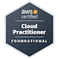
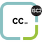

# Alex Hedley

## Badges

### AWS

#### Certified

- Cloud Practitioner (Foundational)

### GitHub

- Foundations
- Copilot

### ISC2

<!-- [²-007054.svg?style=for-the-badge&logo=iscsquared&logoColor=white)](https://www.isc2.org/) -->

- Certified in Cybersecurity℠ - CC

